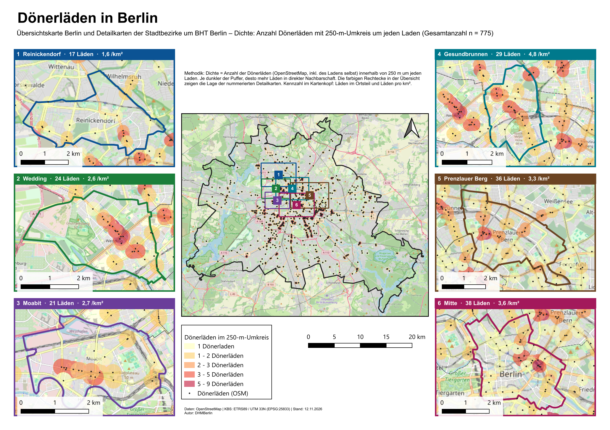
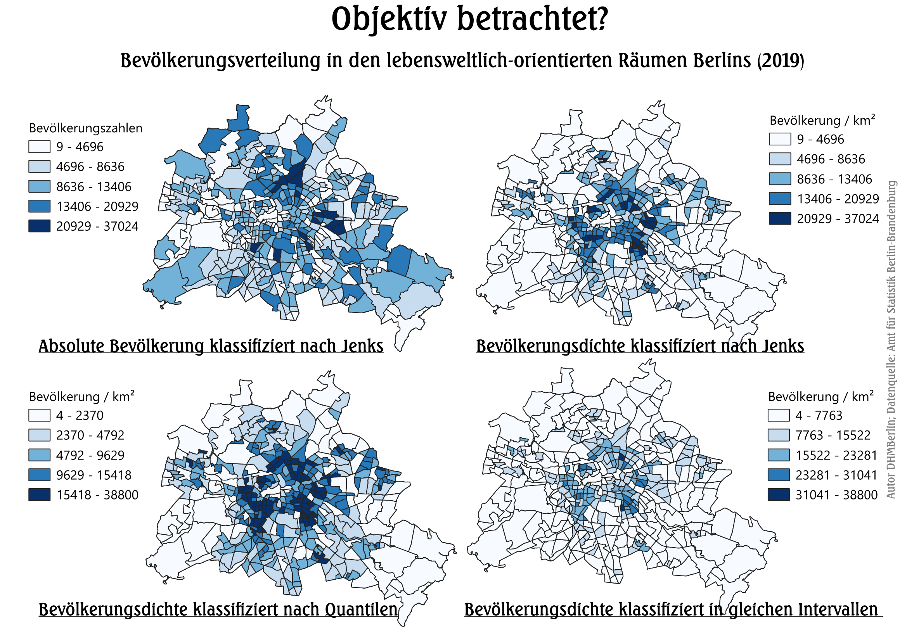
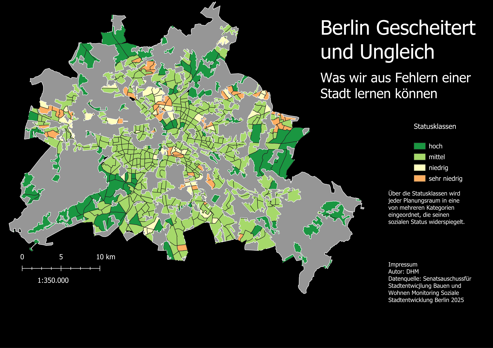

# EP 1 UE 3 Standortanalyse
Standortanalyse

Berlin-Grenze, Ortsteilgrenzen und Dönerläden laden und lokal zwischenspeichern.
Doppelte OSM-Einträge werden entfernt. Läden, die als Gebäude oder Fläche eingetragen sind, werden auf einen Mittelpunkt reduziert.
Alle Ebenen nach EPSG:25833 (ETRS89 / UTM 33N) umprojizieren, damit der Puffer wirklich 250 m misst.
Nur Läden behalten, die innerhalb der Berlin-Grenze liegen.
Um jeden Laden einen Puffer von 250 m legen, ohne die Puffer zu verschmelzen.
Für jeden Puffer zählen, wie viele Läden darin liegen, den Laden selbst mitgerechnet. Diese Zahl ist die Dichte.
Die Puffer nach dieser Zahl in fünf Klassen einteilen und mit einer Farbskala halbtransparent einfärben.
Für jeden Detail-Ortsteil die Läden darin zählen und durch die Fläche in km² teilen. Das ergibt die Kennzahlen im Kartenkopf.
Das Layout bauen

# EP 1 UE 2 Datenklassifikation
Datenklassifikation

# EP 1 UE 1 Einführung QGIS
## Beispiel
Monitoring Soziale Stadtentwicklung
